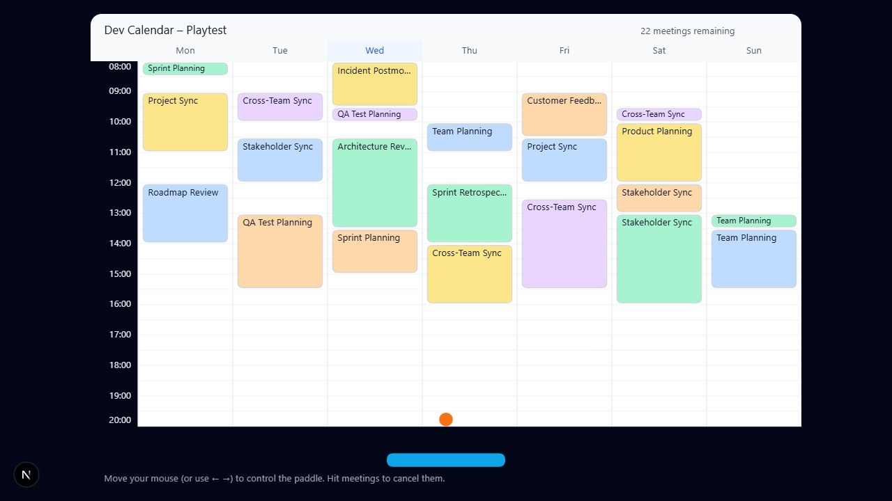
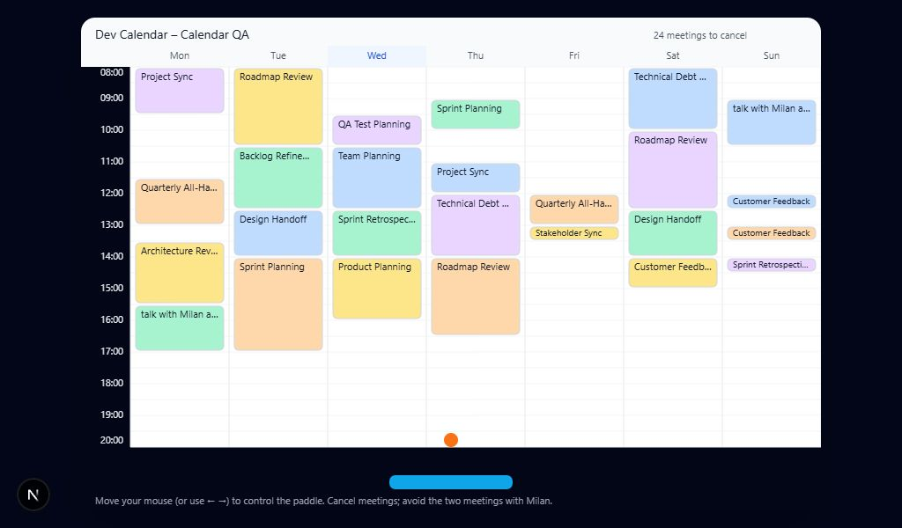

# Desktop browser QA — 2026-10-28

Tested the local game in the built-in Chromium browser. These are CSS viewport tests on this machine, not separate physical monitors or cross-browser certification.

## Bugs reproduced and fixed

- Half-hour meeting labels extended below their boxes. Reduced vertical spacing within each calendar slot to give the shortest box 14 pixels of height, fitted the font to that height, aligned labels within the box, and clipped them to the rounded interior.
- Long titles were horizontally squeezed by canvas fillText maxWidth. Titles now use measured-width ellipsis, with cached fitting results.
- Long player names could overlap the meeting counter. The header title now truncates to its own width.
- 08:00 overlapped the light calendar header. First and last time labels now stay inside the dark time gutter.
- The intro reserved a blank 840×560 canvas below the name form. The inactive canvas is now hidden; the form fits the smallest desktop viewport without scrolling.
- Upscaled canvas text was blurry. The backing buffer now follows display size and device pixel ratio. ResizeObserver redraws the canvas even when the completed round has stopped its animation loop. Physics and input keep their original logical coordinates.

## Viewport results

All game viewports below passed: entire canvas visible, no horizontal/vertical page overflow, and preserved 3:2 aspect ratio (within subpixel rounding).

| CSS viewport | Canvas display size |
| --- | --- |
| 1024×600 | 840×560 |
| 1024×768 | 984×656 |
| 1280×720 | 1020×680 |
| 1366×768 | 1092×728 |
| 1440×900 | 1100×733.33 |
| 1920×1080 | 1100×733.33 |
| 2560×1440 | 1100×733.33 |
| 3440×1440 | 1100×733.33 |
| 3840×2160 | 1100×733.33 |

The existing 1100-pixel maximum board width is preserved. The intro also passed at 1024×600, 1280×720, 1366×768, 1920×1080, and 3840×2160. At 1023 pixels wide the existing Desktop Only notice appeared; returning to 1024 restored the intro.

## Gameplay and timing

Observed in browser: mouse paddle movement, arrow-key movement, ball movement, meeting cancellation and live counter update, game-over return, restart, and resizing during a round. No browser console warnings or errors were captured.

A temporary requestAnimationFrame probe sampled 300 intervals at 1366×768: average 8.332 ms, 95th percentile 8.4 ms, maximum 8.5 ms (approximately 120 Hz). This is a short development-session sample, not a guarantee across hardware or refresh rates. The probe was removed from the codebase after measurement.

Actual browser device pixel ratio was 1. A 2× pixel ratio, scaled pointer mapping, shortest meeting text bounds, win/New day lifecycle, and frame/timer cleanup are covered by automated tests. The winning state was not reached manually during this browser pass.

## Validation and evidence

24 automated tests passed; ESLint, TypeScript, and the webpack production build passed.

- [Raw viewport and timing results](viewport-results.json)
- [Small-desktop gameplay](desktop-1024x600.png)
- [Small-desktop intro](intro-1024x600.png)
- [Laptop gameplay](desktop-1366x768.png)
- [Full-HD gameplay](desktop-1920x1080.png)

## Follow-up: meeting names and launch speed

Replaced the joke meeting titles with common team meetings, including Sprint Retrospective, Code Review, Backlog Refinement, Release Planning, and Customer Feedback. Increased starting ball speed from 2.4 to 3 logical pixels per physics tick (25% faster, 180 pixels per second at 60 Hz).

Browser-checked the updated labels, restart, and arrow controls. No browser console errors or warnings were captured. All 25 automated tests, ESLint, TypeScript, and the production build passed. The added launch test verifies one second of actual ball travel.

## Follow-up: protected Milan meetings

Every calendar now contains exactly two pink meetings titled **talk with Milan about memes**. Placement reserves opposite ends of the week, separated vertically by at least 200 logical pixels, before generating ordinary meetings. The counter and win condition include only ordinary meetings.

Browser QA covered the new intro and full two-line meeting labels at 1024×600, plus the modal at 1024×600 and 1920×1080. Using temporary controlled launch positions, the real physics collision was exercised against each protected meeting. Both displayed the exact requested message. The modal received keyboard focus; Try again regenerated the calendar, and Escape dismissed the popup. All controlled launch code was removed, and a final normal launch was verified. No browser console errors or warnings were captured.

28 automated tests passed, including exactly two distant, non-overlapping Milan meetings across 300 calendars, loss on either meeting, popup persistence and retry, and winning while preserving the protected meetings. ESLint, TypeScript, and the production build passed.

- [Intro rule](milan-intro.png)
- [Two distant Milan meetings](milan-meetings.png)
- [Milan game-over popup](milan-game-over.png)

## Follow-up: Milan meetings blend in

Removed the special pink fill, red/bold border, bold text, and two-line layout. Milan meetings now go through exactly the same palette, one-pixel gray border, normal font, and measured single-line label rendering as every other meeting. Instructions no longer refer to a special meeting color. Exactly two Milan meetings and the collision/popup rule are unchanged.

Verified the appearance in browser at 1024×600 with no console errors or warnings. All 29 automated tests, lint, TypeScript, and the production build passed. A rendering regression test checks the shared styling for every meeting.

